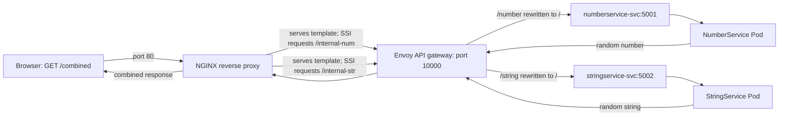

# Gateway and Reverse Proxy Demo

This repository is a small Kubernetes example that combines two Python services into one browser response. NGINX is the public entry point, Envoy routes internal API requests, and the Python services generate a random number and a random string.

The example is intended to make a few common infrastructure building blocks easier to understand. The manifests are configuration for Kubernetes; they are not a complete production deployment.

## The Idea in Plain Language

Imagine a front desk receiving a visitor's request and asking several departments for information:

- A **service** is one small program with one job. Here, NumberService returns a random four-digit number and StringService returns five random lowercase letters.
- A **Kubernetes Service** is a stable address for reaching a group of matching Pods. Pods can be replaced and their IP addresses can change; clients use the Service name instead.
- A **deployment** tells Kubernetes how to run and maintain a set number of copies of a program. Kubernetes creates those running copies, called Pods, and replaces them if they stop working.
- A **gateway** is an API traffic director. Envoy receives requests and chooses a backend based on the URL path.
- A **reverse proxy** accepts a request on behalf of other programs and forwards requests to them. NGINX is the outside-facing reverse proxy in this example. It also assembles the two service responses into one page.
- A **load balancer** gives clients a stable entry point and sends traffic to available Pods behind it. Here, the NGINX Kubernetes Service is declared as type `LoadBalancer`.

These names describe different responsibilities. A Kubernetes Service is not the same thing as a Python service: the Python program does the work, while its Kubernetes Service provides a network address for reaching its Pod or Pods.

## Request Flow



In more detail:

1. The browser requests `http://localhost/combined` (or the address of the cluster's load balancer).
2. The `reverse-proxy-svc` Service sends the request to an NGINX Pod on port 80.
3. NGINX serves `combined.tmpl`. Server Side Includes (SSI) cause NGINX to make internal subrequests for `/internal-num` and `/internal-str` and insert their responses into the template.
4. Both internal NGINX locations proxy to Envoy through the Kubernetes Service `api-gateway-svc` on port 10000. The locations are marked `internal`, so a browser cannot call those paths directly.
5. Envoy matches `/number` or `/string`, removes that prefix by rewriting the path to `/`, and forwards the request to the corresponding Kubernetes Service.
6. The Python program handles `/` and returns plain text. NGINX inserts both results into the page and sends the combined response to the browser.

The two SSI includes are separate internal subrequests. The configuration does not promise that they execute in parallel.

The output has this shape, with new random values on each request:

```text
Number_String = 6009_bhxqg
```

The number is randomly selected from 1000 through 9999. The string contains five randomly selected lowercase letters.

## Ports and Network Access

| Component | Port | Who can reach it? | Purpose |
| --- | ---: | --- | --- |
| NumberService container | 5001 | Inside the cluster through `numberservice-svc` | Returns a random number |
| `numberservice-svc` | 5001 | Other cluster workloads | Stable address for NumberService Pods |
| StringService container | 5002 | Inside the cluster through `stringservice-svc` | Returns a random string |
| `stringservice-svc` | 5002 | Other cluster workloads | Stable address for StringService Pods |
| Envoy container | 10000 | Inside the cluster through `api-gateway-svc` | Accepts API traffic from NGINX |
| `api-gateway-svc` | 10000 | Other cluster workloads | Stable address for Envoy Pods |
| NGINX container | 80 | Through `reverse-proxy-svc` | Accepts the browser request |
| `reverse-proxy-svc` | 80 | Outside the cluster via `LoadBalancer` | Public entry point for the demo |

The `containerPort` fields describe which port a container uses; they do not by themselves publish that port on your computer. Kubernetes Services provide stable in-cluster addresses, and the `LoadBalancer` Service provides the intended external entry point. The application and gateway Services omit `type`, so Kubernetes creates them as internal `ClusterIP` Services by default.

Kubernetes DNS lets workloads refer to Services by names such as `api-gateway-svc` and `numberservice-svc`; they do not need to know the current Pod IP addresses.

## What Each File Defines

- [`apps.yaml`](apps.yaml) creates the `microservices-code` ConfigMap, the NumberService and StringService Deployments, and their internal Services.
- [`gateway.yaml`](gateway.yaml) creates the Envoy configuration ConfigMap, the Envoy Deployment, and `api-gateway-svc`.
- [`rp_configmaps.yaml`](rp_configmaps.yaml) creates NGINX's configuration and template ConfigMaps, the NGINX Deployment, and `reverse-proxy-svc`.
- [`rp_deployment.yaml`](rp_deployment.yaml) repeats the NGINX Deployment and `reverse-proxy-svc` definitions that are already in `rp_configmaps.yaml`. They use the same Kubernetes resource names, so applying both does not create a second independent proxy. The commands below apply `rp_configmaps.yaml` and leave this duplicate file out.

## Images and Configuration

A container image is a packaged filesystem and software that Kubernetes can start as a container. The manifests refer to these public images:

| Image | Used by | What it provides |
| --- | --- | --- |
| `python:3.10-alpine` | NumberService and StringService | Python runtime on a small Alpine Linux base |
| `envoyproxy/envoy:v1.28-latest` | API gateway | Envoy proxy executable |
| `nginx:alpine` | Reverse proxy | NGINX web server and reverse proxy |

When a Pod is scheduled, the Kubernetes node downloads an image from its container registry if the image is not already available locally. Kubernetes then starts the program from that image. These manifests use public image names and do not define custom image builds or registry credentials.

The images do not contain this repository's Python code or the proxy settings. Those are supplied separately through Kubernetes ConfigMaps:

- `microservices-code` stores the two Python scripts. The Python container starts the relevant script from `/app` and listens on `0.0.0.0` at port 5001 or 5002.
- `gateway-config` stores `envoy.yaml`, which Envoy reads from `/etc/envoy` when it starts.
- `reverse-proxy-config` stores `nginx.conf`, mounted at `/etc/nginx/nginx.conf`.
- `reverse-proxy-template` stores `combined.tmpl`, mounted at `/var/www/templates/combined.tmpl`.

This lets the example change application code or proxy settings without building a new image. The containers still need to be restarted when a changed file must be read again at process startup. In particular, the NGINX files are mounted using `subPath`, so restarting the NGINX Deployment is the reliable way to pick up a ConfigMap update.

## Run the Demo

Prerequisites: Docker Desktop with its Kubernetes cluster enabled, and `kubectl` configured to use that cluster. The same manifests can be used with another Kubernetes cluster that supports `LoadBalancer` Services.

From this repository directory, apply the resources:

```sh
kubectl apply -f apps.yaml
kubectl apply -f gateway.yaml
kubectl apply -f rp_configmaps.yaml
```

Check that the Pods are ready and inspect the public Service:

```sh
kubectl get pods
kubectl get services
```

Open `http://localhost/combined` in a browser. On Docker Desktop, the local Kubernetes load balancer commonly makes the Service available at localhost. If the cluster assigns a different external address, use the `EXTERNAL-IP` shown by `kubectl get services` instead.

If the cluster does not provide a working local LoadBalancer address, use port-forwarding as a fallback:

```sh
kubectl port-forward service/reverse-proxy-svc 8080:80
```

Then open `http://localhost:8080/combined` while that command is running.

Applying these manifests initially is enough to start the workloads; rollout restarts are not needed just after `kubectl apply`. If you later change ConfigMap content and want the running processes to reread it, restart the deployments:

```sh
kubectl rollout restart deployment/numberservice-deployment
kubectl rollout restart deployment/stringservice-deployment
kubectl rollout restart deployment/api-gateway-deployment
kubectl rollout restart deployment/reverse-proxy-deployment
```

## Load Balancing and Scaling

Envoy declares a `ROUND_ROBIN` load-balancing policy for each backend cluster. Each Envoy cluster currently has one configured endpoint: the corresponding Kubernetes Service DNS name. Each Python Deployment also has just one replica, so this setup is a routing demonstration rather than a high-availability deployment.

If you increase a Deployment's replica count, Kubernetes creates additional matching Pods. The Service continues to provide one stable name and directs traffic to its matching Pods. A `LoadBalancer` Service likewise provides an outside entry point and forwards traffic to its selected Pods. Actual external load-balancer behavior depends on the Kubernetes environment.

## Troubleshooting

- **The browser cannot connect:** Check `kubectl get services` for `reverse-proxy-svc` and its external address. Try the port-forwarding instructions above if the external address is pending or inaccessible.
- **A Pod is not ready or keeps restarting:** Run `kubectl get pods` and then `kubectl describe pod <pod-name>` to inspect its events.
- **The page loads but a backend request fails:** Check logs with `kubectl logs deployment/reverse-proxy-deployment`, `kubectl logs deployment/api-gateway-deployment`, or the relevant Python Deployment name.
- **A changed ConfigMap does not appear:** Restart the Deployment that consumes it using the commands above.
- **The output differs from the example:** That is expected; both values are generated randomly for each request.

## Remove the Demo

Delete the resources created by the recommended commands:

```sh
kubectl delete -f rp_configmaps.yaml
kubectl delete -f gateway.yaml
kubectl delete -f apps.yaml
```